@'
# One-Person Tech Studio 🚀
> Autonomous, production-grade engineering assets spanning AI governance, event-driven streaming, data contracts, and operational state machines.

[](https://github.com/RemoGodsora/solopreneur)
[](https://python.org)
[](https://fastapi.tiangolo.com)
[](https://docker.com)
[](LICENSE)

This repository serves as the central monorepo for a one-person digital systems studio. Each directory contains an independent, containerized, test-covered production service designed to solve high-friction operational and infrastructure bottlenecks.

---

## Flagship Studio Systems

| # | System | Core Architecture & Stack | Primary Problem Solved | Status |
| :-: | :--- | :--- | :--- | :-: |
| **01** | [**Solo AI Engine**](./solo-ai-engine) | **FastAPI, SQLite (async), Groq, Pydantic v2, Docker** | Uncontrolled LLM token consumption, lack of tenant quota enforcement, and unvalidated outputs in agency workflows. | `Production` |
| **02** | [**StreamPulse**](./streampulse) | **Redpanda (Kafka C++), Redis ZSET, FastAPI SSE, Groq** | Alert fatigue and static threshold failures in high-throughput telemetry; automated $Z \ge 3.5\sigma$ anomaly triage. | `Production` |
| **03** | [**SchemaSentinel**](./schemasentinel) | **DuckDB, Pydantic, Typer CLI, Python AST** | Downstream pipeline breakage from upstream schema drift; automated in-memory contract validation and self-healing SQL views. | `Production` |
| **04** | [**Autonomous Ops Agent**](./autonomous-ops-agent) | **LangGraph, DuckDB, Groq, Webhooks, FastAPI** | Repetitive financial reconciliation; deterministic state-graph pipeline with human-in-the-loop pause gates and SHA-256 audit seals. | `Production` |

---

## Architecture Overview

```mermaid
flowchart TD
    subgraph Layer1["01. AI Gateway & Ingestion"]
        A[Inbound Prompts / Transcripts] --> B[Solo AI Engine]
        B -->|SHA-256 Auth & Quota Check| C[(SQLite / Storage)]
        B -->|Deterministic PDF Output| D[Executive Briefs]
    end

    subgraph Layer2["02. Real-Time Telemetry & Streaming"]
        E[High-Throughput Metric Stream] --> F[Redpanda Broker]
        F --> G[Redis 30s Sliding Window]
        G -->|Z >= 3.5 sigma Spike| H[StreamPulse SRE Diagnostic]
        H -->|Server-Sent Events| I[Live SSE Incident Visualizer]
    end

    subgraph Layer3["03. Data Governance & Pipelines"]
        J[Upstream Drifted CSV / JSON] --> K[SchemaSentinel Validator]
        K -->|DuckDB In-Memory AST| L{Contract Check}
        L -->|Breach Detected| M[Autonomous SQL View Synthesis]
    end

    subgraph Layer4["04. Autonomous Digital Labor"]
        N[Raw Vendor Invoices] --> O[Autonomous Ops Agent]
        O -->|LangGraph State Machine| P[DuckDB Purchase Order Check]
        P -->|Variance > $500| Q[HITL Pause Gate: Webhook Alert]
        Q -->|Operator Signoff| R[SHA-256 Sealed Audit Certificate]
    end
```



## Directory Navigation
```Plaintext
solopreneur/
├── solo-ai-engine/           # Product #1: Multi-tenant AI governance & inference proxy
│   ├── main.py               # Gateway endpoints, quota middleware & telemetry
│   ├── database.py           # Async SQLAlchemy ORM models & tenant entities
│   └── templates/            # Print-ready CSS brief & governance dashboard
│
├── streampulse/              # Product #2: Event-driven telemetry & anomaly triage
│   ├── producer.py           # High-throughput synthetic telemetry generator
│   ├── consumer.py           # Sliding-window statistical filter & Groq attribution
│   └── api/                  # FastAPI SSE streaming gateway & incident dashboard
│
├── schemasentinel/           # Product #3: Autonomous data contracts & self-healing SQL
│   ├── cli/main.py           # Typer CLI for validation and AST healing
│   ├── core/validator.py     # DuckDB SQL rule evaluator
│   └── core/healer.py        # Deterministic schema adapter generator
│
└── autonomous-ops-agent/     # Product #4: Graph-based reconciliation agent
    ├── core/graph.py         # LangGraph cyclical state machine & safety barriers
    ├── tools/ledger.py       # DuckDB PO cross-examination tool
    └── api/gateway.py        # Webhook listeners & review resumption endpoints
```

## Unified Local Verification

All four systems feature isolated virtual environments, comprehensive Pytest test suites, and Docker Compose configurations.   

```Bash
# Verify System #1 (Solo AI Engine)
cd solo-ai-engine && pytest -v

# Verify System #2 (StreamPulse)
cd ../streampulse && docker compose up -d

# Verify System #3 (SchemaSentinel)
cd ../schemasentinel && python -m cli.main --contract contracts/orders_v1.yaml --data data/orders_corrupted.csv

# Verify System #4 (Autonomous Ops Agent)
cd ../autonomous-ops-agent && pytest -v
```

## License
MIT License. Engineered and maintained by @[RemoGodsora](https://www.google.com/search?q=https://github.com/RemoGodsora).