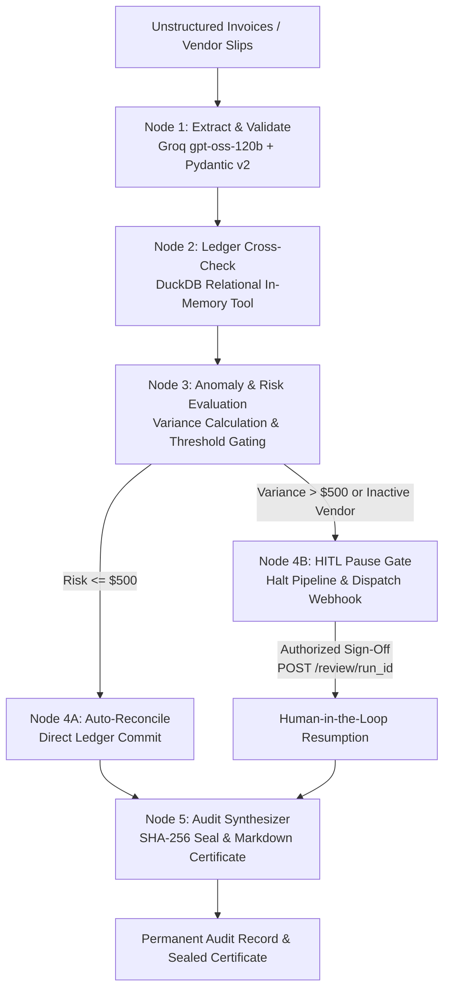

# Autonomous Operations & Reconciliation Agent 🤖💼
> Enterprise Financial Reconciliation Agent with Deterministic State Graphs, DuckDB Cross-Checking, and Human-in-the-Loop (HITL) Pause Gates.

[](https://python.org)
[](https://fastapi.tiangolo.com)
[](https://langchain-ai.github.io/langgraph/)
[](https://duckdb.org)
[](https://docker.com)
[](https://pytest.org)
Autonomous Operations Agent automates complex enterprise reconciliation, billing validation, and audit workflows. Unlike non-deterministic conversational chatbots, it runs on a state-machine graph: parsing unstructured invoices, cross-examining against DuckDB relational purchase orders, algorithmically evaluating financial risk, halting at deterministic pause gates for human operator authorization, and cryptographically sealing every step under a SHA-256 audit hash.
---
## System Architecture


## Core Capabilities

* State-Graph Execution (LangGraph): Replaces brittle sequential prompts with a typed, cyclical state machine that supports checkpointing, state serialization, and conditional branching.
* Embedded Analytical Ledger (DuckDB): Zero-infrastructure, vectorized analytical checks evaluating live documents against active vendor directories, contracted rate caps, and approved purchase orders.
* Deterministic Human-in-the-Loop (HITL) Gates: High-variance invoices automatically interrupt the pipeline, minting a one-time authorization token (AUTH-...) and halting execution until authorized human review is completed.
* Automated Webhook Dispatch: Instantly fires high-contrast operational review embeds to Slack/Discord channels whenever a gate is breached.
* Cryptographic Auditability: Generates an immutable, timestamped execution trail sealed with a SHA-256 hash digest, producing compliance-ready Markdown/PDF audit certificates.
* Fully Containerized: Ready for production deployment using Docker Compose with zero environmental drift.

## Technical Stack

| **Component** |	**Technology**	| **Role** |
| :--- | :--- | :--- |
| **Orchestration** |	LangGraph |	State machine, conditional branching, interrupt boundaries |
| **Inference Layer** |	Groq SDK (openai/gpt-oss-120b) |	High-speed structured extraction into Pydantic models |
| **Ledger Tooling** |	DuckDB |	Relational SQL cross-examination of POs and rate limits |
| **API Gateway** |	FastAPI / Uvicorn |	REST endpoints for ingestion, reviews, and certificates |
| **State Models** |	Pydantic v2 |	Strictly typed pipeline state, invoices, and audit logs |
| **Alerting** |	HTTPX / Webhooks |	Asynchronous operational notification dispatch |
| **Containerization** |	Docker / Compose |	Multi-stage, reproducible microservice container |

## Project Directory Layout

```Plaintext

autonomous-ops-agent/
├── core/
│   ├── state.py              # Strongly-typed graph state & audit models
│   ├── engine.py             # Groq structured document inference engine
│   └── graph.py              # LangGraph workflow, nodes & conditional edges
├── tools/
│   ├── ledger.py             # Vectorized DuckDB analytical verification tool
│   └── notifier.py           # Webhook notification dispatcher (Discord/Slack)
├── checkpoints/
│   └── approval.py           # In-memory approval persistence & state resume
├── audit/
│   └── generator.py          # Deterministic SHA-256 audit certificate generator
├── api/
│   └── gateway.py            # FastAPI endpoints (submit, review, certificate)
├── tests/
│   └── test_agent_graph.py   # Pytest async regression test suite
├── Dockerfile                # Multi-stage lightweight Python container
├── docker-compose.yml        # Orchestrated service definition
├── pyproject.toml            # Pytest & package configuration
├── requirements.txt          # Frozen dependency locks
└── run_demo.py               # Standalone pipeline CLI runner
```

## Quickstart
### 1. Prerequisites
* Python 3.11+
* Docker & Docker Compose installed
* A valid Groq Cloud API Key

### 2. Environment Configuration
Create a .env file in the root of autonomous-ops-agent:
```env
GROQ_API_KEY=your_groq_api_key_here
DISCORD_SLACK_WEBHOOK_URL=https://discord.com/api/webhooks/your_id/your_token  # (Optional)
```

### 3. Run Locally with Virtual Environment
```Bash

# Set up venv
python -m venv venv
.\venv\Scripts\Activate.ps1    # On Linux/macOS: source venv/bin/activate
# Install dependencies
pip install -r requirements.txt
# Run the standalone pipeline demo
python run_demo.py
# Launch the API Gateway
uvicorn api.gateway:app --reload --port 8002
```

### 4. Containerized Launch (Docker Compose)
```bash
docker compose up --build -d
```

The gateway is available at `http://localhost:8002`.  
Interactive Swagger documentation is live at `http://localhost:8002/docs`.

## REST API Reference
### 1. Submit Document for Autonomous Reconciliation
`POST /api/v1/operations/submit`
Request Body:
```JSON

{
  "document_text": "INVOICE #: INV-2026-9099\nVendor: CloudScale Hosting (ID: VEND_001)\nDate: 2026-10-19\nCurrency: USD\nLine Items:\n- Dedicated Kubernetes Cluster: $10,500.00\n- Multi-region egress transfer: $3,700.00\nSubtotal: $14,200.00\nTax: $0.00\nTotal Amount: $14,200.00\nPO Reference: PO-2026-901"
}
```
Response (Halted on High-Risk Variance):
```JSON

{
  "run_id": "ops-199092c3",
  "status": "pending_human_approval",
  "risk_level": "HIGH",
  "discrepancy_amount": 1700.0,
  "approval_token": "AUTH-02C65E7E96EB",
  "audit_hash": "a70df1fb2e0d8e0dcde535..."
}
```
### 2. Submit Human-in-the-Loop Operator Review
`POST /api/v1/operations/review/{run_id}`
**Request Body:**
```JSON

{
  "approval_token": "AUTH-02C65E7E96EB",
  "action": "approve",
  "operator_notes": "Variance authorized by Lead Systems Architect."
}
```
**Response:**
```JSON

{
  "run_id": "ops-199092c3",
  "status": "reconciled",
  "message": "Human-in-the-loop decision applied: reconciled."
}
```
### 3. Retrieve Cryptographic Audit Certificate
`GET /api/v1/operations/certificate/{run_id}`
**Response:**
```JSON

{
  "run_id": "ops-199092c3",
  "audit_hash": "a70df1fb2e0d8e0dcde5350a61b88c7fdf3c1a20cb39210eabbd98fba35a5cec",
  "certificate_markdown": "# OPERATIONAL AUDIT CERTIFICATE\n..."
}
```
## Automated Testing Suite
The engine includes automated regression tests covering clean reconciliation runs, DuckDB cross-checks, variance thresholds, and human-in-the-loop pause gates:
```Bash

pytest -v
```
Expected output:
```Plaintext

tests/test_agent_graph.py::test_low_risk_auto_reconciliation PASSED  [ 50%]
tests/test_agent_graph.py::test_high_risk_pause_gate         PASSED  [100%]
============================== 2 passed in 5.23s ==============================
```
## License
MIT License. Designed and maintained for production operational systems.

---
