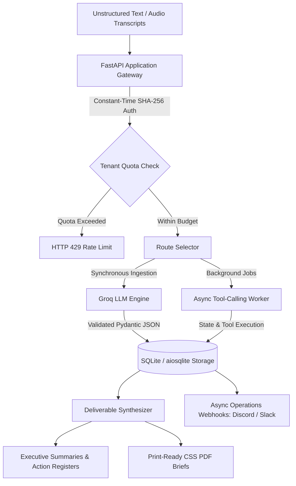

# Solo AI Studio — Deterministic Agency Intelligence Engine

An enterprise-ready, multi-tenant asynchronous intelligence extraction platform. The engine ingests unstructured discovery recordings, project transcripts, and stakeholder notes, converting them into validated executive briefs, prioritized action registers, and deterministic PDF audit reports.

---

[](https://github.com/RemoGodsora/solo-ai-engine/actions/workflows/ci.yml)


> **Live Walkthrough**: [Watch the 84-Second Architecture & Demo on YouTube](https://youtu.be/ST0TsyK9mrs) 📺

## High-Level Architecture



---

## Core Capabilities

- **Multi-Tenant Isolation**: Hard organizational separation using SHA-256 keyed tenant identifiers and automatic monthly quota throttling.
- **Deterministic Extraction**: Zero hallucinated schemas. Structured strictly via Pydantic response models and validated outputs.
- **Asynchronous Execution**: Background execution engine capable of reasoning over complex operational inputs via tool-calling.
- **Executive PDF Export**: Embedded CSS print engine generating clean, high-contrast client audit reports with zero external browser dependencies.
- **Containerized Deployment**: Single-command provisioning via Docker Compose with volume-backed persistence.

---

## Tech Stack

- **Backend**: FastAPI, Python 3.11+, Pydantic v2
- **Database & ORM**: SQLite, SQLAlchemy 2.0 (AsyncIO), aiosqlite
- **AI / LLM Engine**: Groq SDK (`openai/gpt-oss-120b`)
- **Frontend / Rendering**: Jinja2 Templates, Tailwind CSS (CDN)
- **Infrastructure**: Docker, Docker Compose

---

## Quickstart

### 1. Environment Configuration
Create a `.env` file in the root directory:

```bash
GROQ_API_KEY=your_groq_api_key_here
MASTER_ADMIN_KEY=dev_secret_key_123
DATABASE_URL=sqlite+aiosqlite:///./studio.db
```

### 2. Containerized Launch
Spin up the application stack:

```bash
docker compose up --build -d
```

- Access the client dashboard: `http://localhost:8000`
- Interactive OpenAPI / Swagger docs: `http://localhost:8000/docs`

---

## Testing & Quality Assurance

Run the test suite to verify tenant isolation, background agent tools, and reporting formatting:

```bash
pytest -s
```

# Solo AI Studio (`v1.2.0`)

[](https://github.com/RemoGodsora/solo-ai-engine/actions/workflows/ci.yml)


> Multi-tenant asynchronous intelligence engine designed for autonomous operations. Features tenant key hashing, monthly quota governance, live operational alerts (Discord/Slack), and executive print-ready PDF brief synthesis.

### Public Walkthrough
- [Watch the 60s Demo on LinkedIn](https://lnkd.in/p/dcVZPa4C)
- [Launch Announcement on X](https://x.com/RemoKING17/status/2108416129039499655?s=20)
- [YouTube Walkthrough](https://www.youtube.com/watch?v=ST0TsyK9mrs)